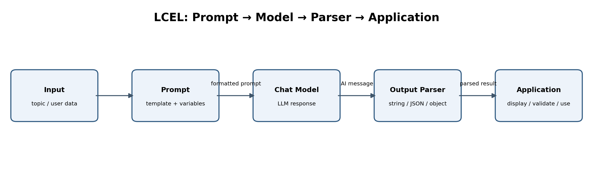
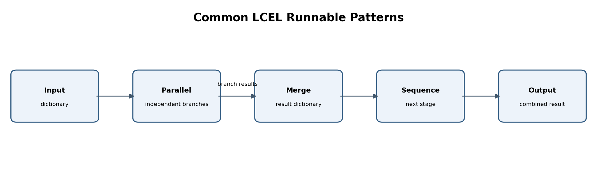
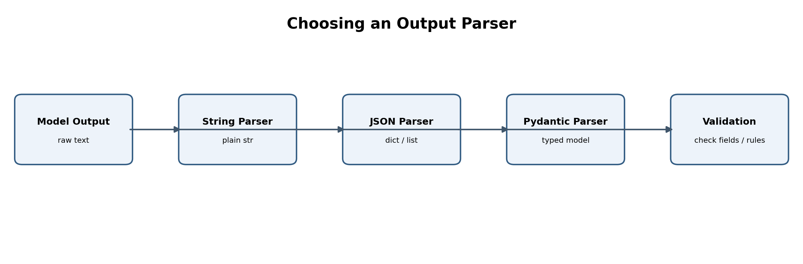

# Next-Level Prompt Engineering with LangChain
## Course guide, architecture diagrams, and notebook navigation

This folder contains five Jupyter notebooks for a practical five-day Prompt Engineering course using LangChain and a Groq-hosted chat model. Day 5 includes an extended section on output parsers, LCEL, runnable components, and chain design.

> **Execution note:** Notebook syntax and structure were checked, but not every model-backed cell has been executed against a live provider. Model names, provider features, rate limits, and package APIs can change. Run notebooks from top to bottom and verify the selected model is currently supported.

---

## 1. Course index — prompting topics covered

This index gives a quick view of the prompting concepts and LangChain skills covered across the five notebooks.

### Day 1 — Prompting Fundamentals
- What prompt engineering is and why prompt quality matters
- Improving vague prompts and making instructions specific
- Zero-shot, one-shot, and few-shot prompting
- Prompt structure: role, task, context, input, constraints, and output format
- Prompt anatomy and writing clear instructions
- Delimiters for separating instructions from user-provided data
- Negative instructions, boundary conditions, and fallback directions
- Prompt quality checklist and hands-on practice

### Day 2 — Reusable PromptTemplate
- Why reusable prompt templates are useful
- Creating templates with `PromptTemplate.from_template()`
- Single and multiple input variables
- Formatting prompts with `format()` and `format_prompt()`
- Reusing one template with different input data
- Required input variables and input validation
- Partial variables for fixed role, tone, or context
- Escaping literal curly braces and avoiding common template mistakes

### Day 3 — ChatPromptTemplate and Conversation Context
- Building chat prompts with `ChatPromptTemplate`
- System, human, and AI message roles
- Creating prompts with multiple messages
- Using `MessagesPlaceholder` to insert conversation history
- Building reusable chat functions and checking inputs
- Passing conversation history as context
- Managing and limiting history windows
- Understanding the difference between supplied chat history and permanent memory

### Day 4 — Advanced Prompting Techniques
- `FewShotPromptTemplate` and example-based prompting
- Example selection with `LengthBasedExampleSelector`
- Semantic-similarity example selection (optional extension)
- Role-based, contextual, and constraint-based prompting
- Stepwise prompting and ReAct prompting concepts
- Task decomposition for multi-stage problems
- Self-review, critique, and revise workflows
- Prompt-injection awareness and trusted/untrusted input boundaries
- Prompt evaluation using repeatable criteria and test examples

### Day 5 — Output Parsers, LCEL, and Prompt Chains
- Turning model responses into plain text, JSON, lists, XML, or typed objects
- `StrOutputParser`, `JsonOutputParser`, `PydanticOutputParser`, and list/XML parsers
- Pydantic schemas, field constraints, and type validation
- `parse()` versus chain `invoke()`
- Native structured output versus parser-based formatting
- LCEL fundamentals and the `prompt | model | parser` pattern
- Prompt chaining and sequential workflows
- Runnable components: `RunnableSequence`, `RunnableParallel`, `RunnablePassthrough`, `RunnableLambda`, and `RunnableBranch`
- `.assign()`, `itemgetter`, fallbacks, and retries
- `invoke()`, `batch()`, `stream()`, and async execution methods
- Parser/model error handling, chain debugging, and an IT support ticket workflow

### Quick notebook map

| Notebook | Main focus | Main outcome |
|---|---|---|
| `Day_1_Prompting_Fundamentals.ipynb` | Prompting basics and prompt design | Write clear, structured prompts |
| `Day_2_PromptTemplate.ipynb` | Reusable text prompts | Build and validate variable-based templates |
| `Day_3_ChatPromptTemplate.ipynb` | Chat messages and history | Build conversational prompts with context |
| `Day_4_Advanced_Prompting.ipynb` | Advanced prompt strategies | Design multi-step, example-driven, evaluated prompts |
| `Day_5_Output_Parsers_LCEL.ipynb` | Parsing and chain composition | Build structured, testable LangChain workflows |

**Recommended learning path:** Prompt fundamentals → reusable templates → chat prompts and history → advanced prompting → output parsers and LCEL chains.

---

## 2. Day-by-day explanations

### Day 1 — Prompting Fundamentals

**What it is:** Prompt engineering is the practice of expressing a task, context, constraints, and expected response clearly.

**Why it is useful:** Clear instructions reduce ambiguity and make outputs easier to assess and reuse.

**Important concepts:**
- Zero-shot prompting: ask the model to perform a task without examples.
- One-shot prompting: provide one example of the desired input/output.
- Few-shot prompting: provide multiple examples to demonstrate a pattern.
- Prompt anatomy: role, task, context, input, constraints, and output format.
- Delimiters: mark where supplied data begins and ends.
- Negative instructions: specify what the model should avoid, with a positive fallback rule where possible.

**Practical use:** Ticket classification, extracting fields from text, generating learning plans, summarizing documents, and drafting support replies.

### Day 2 — PromptTemplate

**What it is:** `PromptTemplate` is a reusable text template with named variables such as `{topic}` and `{audience}`.

**Why it is useful:** The instruction can remain stable while application data changes. This avoids manually rebuilding similar prompts.

**Important concepts:**
- `from_template()` creates a template from a string.
- `input_variables` identifies required placeholders.
- `format()` fills variables and returns formatted text.
- `partial()` fixes values that are reused, such as a role or tone.
- Validation helps detect missing or mismatched placeholders.
- Literal braces in templates need escaping as `{{` and `}}`.

**Practical use:** Generate consistent course descriptions, reports, explanations, and support responses for many different inputs.

### Day 3 — ChatPromptTemplate

**What it is:** `ChatPromptTemplate` builds a sequence of chat messages rather than one undifferentiated text prompt.

**Why it is useful:** It separates persistent assistant behaviour from the user's current request and supplied conversation history.

**Important concepts:**
- System message: sets assistant behaviour and high-level instructions.
- Human message: contains the user request or supplied input.
- AI message: represents assistant content or prior assistant turns.
- `MessagesPlaceholder`: inserts a list of messages supplied by the application.
- History is not automatically persistent: your application must store, retrieve, and pass it.
- Limit history to relevant turns to manage token use and context quality.

**Practical use:** Multi-turn learning assistants, customer support chatbots, and conversational IT tutors.

### Day 4 — Advanced Prompting

**What it is:** Advanced prompting organizes complex tasks into stages and evaluates generated results against explicit criteria.

**Why it is useful:** A large task becomes easier to test, review, and improve when divided into smaller steps.

**Important concepts:**
- Task decomposition: requirements → outline → draft → review.
- Critique-and-revise: review an answer against a rubric and produce a revision.
- Prompt injection awareness: treat documents and user-supplied text as untrusted data.
- Evaluation: check relevance, correctness, format compliance, consistency, and safety.
- A model-generated review is not proof of correctness; use human or deterministic checks for important outcomes.

**Practical use:** Preparing course content, analyzing support requests, document extraction, and multi-stage content generation.

### Day 5 — Output Parsers, LCEL, and Chains

**What it is:** Output parsers convert model responses into forms that applications can work with. LCEL (LangChain Expression Language) composes prompts, models, parsers, and other runnables into workflows using the pipe operator `|`.

**Why it is useful:** Applications often need predictable strings, dictionaries, or typed objects rather than unstructured model prose.

**Parser choices:**
- `StrOutputParser`: plain Python string.
- `JsonOutputParser`: parsed JSON-like Python dictionary/list.
- `PydanticOutputParser`: a Pydantic model instance with schema/type validation.
- List parsers: parse comma-separated, Markdown, or numbered lists.
- XML parser: parse XML-oriented model output into a structured representation.

**Core LCEL runnable patterns:**
- `RunnableSequence`: run steps in order.
- `RunnableParallel`: run independent branches on the same input and return a dictionary.
- `RunnablePassthrough`: pass input through unchanged.
- `RunnablePassthrough.assign()`: preserve existing input keys and add computed fields.
- `RunnableLambda`: wrap a Python function as a runnable.
- `RunnableBranch`: route input based on conditions.
- `itemgetter`: select fields from an input dictionary.
- `with_fallbacks()`: define an alternate runnable for failures.
- `with_retry()`: retry selected failures.
- `invoke`, `batch`, `stream`, `ainvoke`, `abatch`, `astream`: common execution styles.

**Practical use:** Ticket triage, structured extraction, course-plan generation, multi-step content generation, and backend workflows.

---

## 3. Architecture diagrams

### 3.1 Basic LCEL pipeline



The prompt formats input variables. The model generates a response. The parser transforms the response into the required output type. The application should then validate business rules before using the result.

### 3.2 Runnable composition pattern



Parallel branches are useful when tasks do not depend on each other. Their results can be combined and passed into a later sequential step.

### 3.3 Output parser selection



Choose a parser based on the data type the application needs. Parsing and schema validation do not guarantee factual correctness; validate critical values separately.

---

## 4. Example: end-to-end LCEL data flow

```python
from langchain_core.prompts import PromptTemplate
from langchain_core.output_parsers import StrOutputParser

prompt = PromptTemplate.from_template(
    "Explain {topic} in two simple sentences."
)

chain = prompt | llm | StrOutputParser()

result = chain.invoke({"topic": "SQL"})
print(result)
```

**Data movement:**
1. Input dictionary: `{"topic": "SQL"}`
2. Prompt formats the `{topic}` variable.
3. Chat model receives the formatted prompt.
4. Model returns an AI message.
5. `StrOutputParser` extracts plain text.
6. `result` contains a Python string.

---

## 5. Example: choosing a parser

```python
# Plain text
text_result = (prompt | llm | StrOutputParser()).invoke({"topic": "Docker"})

# Structured JSON-like output
# Build a prompt with JsonOutputParser.get_format_instructions(),
# then compose: prompt | llm | JsonOutputParser()

# Typed structured output
# Define a Pydantic BaseModel, create PydanticOutputParser,
# include parser.get_format_instructions(), then compose:
# prompt | llm | parser
```

Use a string when a person reads the result. Use JSON when flexible fields are needed. Use Pydantic when the application needs a defined schema and typed attributes.

---

## 6. Setup and execution

1. Install the packages using the notebook's setup cell.
2. Restart the Jupyter kernel if installation changed the environment.
3. Create a local `.env` file from `.env.example` and set `GROQ_API_KEY`; the notebooks load it with `python-dotenv`.
4. Confirm `MODEL_NAME` is available in your Groq account.
5. Run each notebook from top to bottom.
6. If an error occurs, inspect the first failing cell and verify package versions, credentials, model availability, and provider limits.

### API key security
The original notebooks contained hardcoded API credentials. The revised notebooks load credentials from a local `.env` file with `python-dotenv`; `.gitignore` excludes `.env` from Git. Revoke and regenerate any key that was previously exposed. Never commit API keys to Git, include them in screenshots, or share notebooks containing secrets. For production, inject environment variables through your deployment platform or use a secrets manager rather than relying on a local `.env` file.

---

## 7. Important production design principles

- Treat model output as untrusted until parsed and validated.
- Validate required keys, types, allowed values, and business rules in Python.
- Do not use a prompt as an authorization or access-control mechanism.
- Require human approval for high-impact actions.
- Avoid logging API keys, passwords, or unnecessary personal information.
- Use retries only for transient failures; retries do not fix invalid credentials or unsupported model names.
- Monitor latency, token usage, rate limits, errors, and model/prompt versions.
- Test prompts with a fixed evaluation set when changing models or prompt wording.

---

## 8. Suggested student mini-projects

1. Build an IT course assistant that creates a five-day plan.
2. Build a support-ticket classifier that returns a Pydantic object.
3. Use `RunnableParallel` to generate a definition, real-world example, and quiz question.
4. Use `RunnableBranch` to route beginner and advanced questions.
5. Build a ticket workflow that summarizes an issue, classifies it, and suggests a safe next step.

### Final learning outcome

By the end of the course, students should be able to write reusable prompts, structure chat messages, create multi-stage prompt workflows, parse model output, explain data flow through LCEL chains, and validate outputs before using them in an application.


## 9. Environment-variable setup with python-dotenv

The notebooks use `load_dotenv()` to read `GROQ_API_KEY` from a local `.env` file.

```text
Next_Level_Prompt_Engineering/
├── .env.example
├── .env              # create locally; never share or commit
├── .gitignore
├── Day_1_Prompting_Fundamentals.ipynb
└── ...
```

Create `.env` by copying `.env.example`, then replace the placeholder:

```dotenv
GROQ_API_KEY=your_actual_groq_api_key
```

The notebooks install `python-dotenv` and run:

```python
import os
from dotenv import load_dotenv

load_dotenv()
GROQ_API_KEY = os.getenv("GROQ_API_KEY")
```

If the key is missing, check that the `.env` file is in the notebook's current working directory or one of its parent directories. Never paste a real key into notebook cells or commit `.env` to source control.
